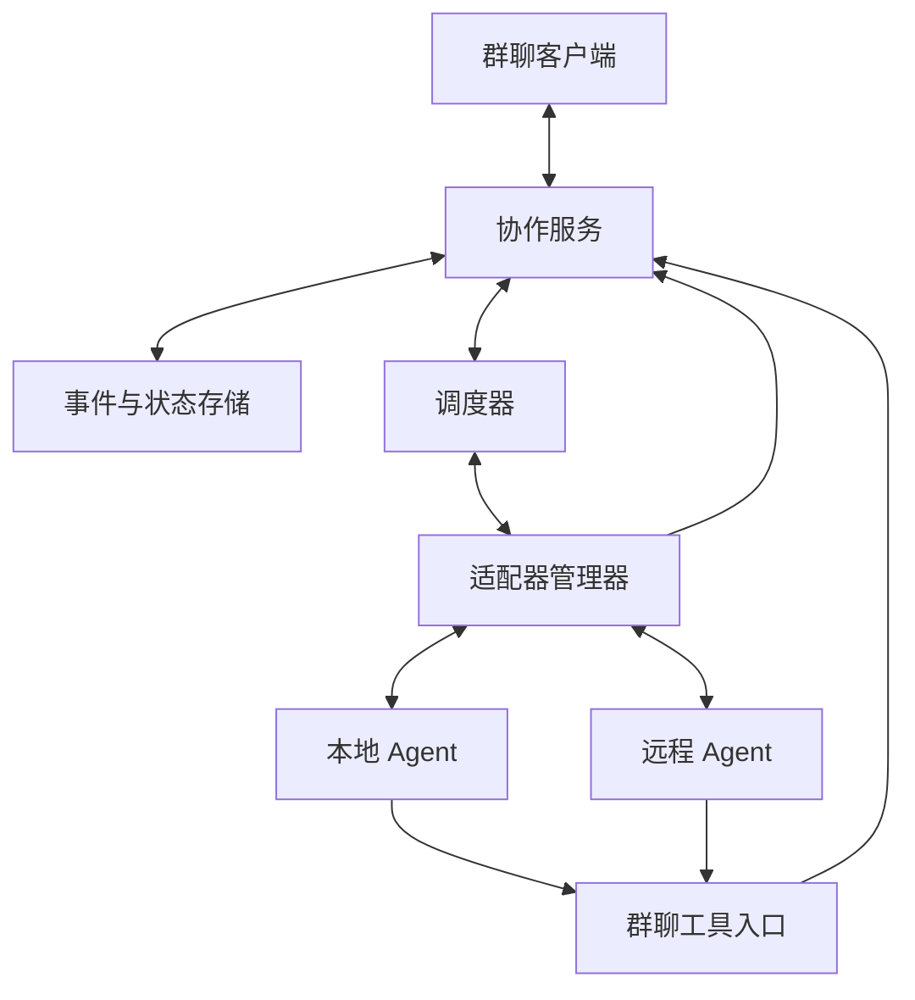

# Roundloom 系统架构草案

> 2026-11-13 更新：首发形态已确定为桌面应用。本文涉及本地 Web 首发的内容为历史候选，桌面进程、通信和生命周期以[桌面架构选型](09-desktop-architecture.md)为当前推荐；其余业务语义继续有效。

版本：v0.1 评审稿  
日期：2026-11-13  
适用范围：群聊式多 Agent 协作工具的建议架构，不代表已有实现

## 1. 架构目标

群聊与任务核心只依赖平台自己的成员、消息、会话、任务和事件语义。适配器负责连接具体 Agent，并保留原生标识与能力差异。新增符合接入契约的 Agent，应通过配置或插件完成，不要求修改群聊和任务的核心业务逻辑。

建议第一阶段采用本地网页界面与本地后台服务；交互界面、协作内核和 Agent 运行时保持清晰边界。后台服务应在网页短暂断线时继续记录执行状态；网页重连只恢复展示，不自动重新执行任务。首发形态与技术栈见[决策清单](00-decisions.md)。

## 2. 组件与责任

| 组件 | 责任 | 主要边界 |
| --- | --- | --- |
| 群聊客户端 | 成员、消息、任务卡、执行详情和用户控制 | 展示后台确认的状态，按能力开放操作 |
| 协作服务 | 成员身份、消息路由、任务归属、交接关联 | 使用稳定成员 ID，维护群与任务的访问范围 |
| 调度器 | 运行队列、会话互斥、协作预算和取消控制 | 控制触发顺序，不自行推断 Agent 原生执行成功 |
| 事件与状态存储 | 保存消息、任务、运行、事件序号和交付证据 | 为重连补齐与问题追踪提供事实记录 |
| 适配器管理器 | 注册插件、校验配置、建立连接、确认能力 | 将各 Agent 协议转换为统一事件与控制操作 |
| 群聊工具入口 | 接收 Agent 的读消息、发消息和报告请求 | 绑定成员身份，支持原生工具、MCP 或可用回调 |
| 工作区与产物管理 | 本地工作目录、代码版本、补丁和测试记录 | 远程成员可不绑定本地目录，产物使用独立引用 |

图中的远程连接和群聊工具入口按各适配器能力提供。支持接收任务与支持主动向群里发消息是不同能力。

## 3. 核心对象

| 对象 | 含义 | 关键关联 |
| --- | --- | --- |
| AdapterPlugin | 一种协议或 SDK 的接入实现 | 插件 ID、契约版本、配置格式 |
| Connection | 一个实际连接配置及连接状态 | 适配器、启动配置或地址、凭据引用、已确认能力 |
| Room | 一个项目协作群 | 成员、消息、任务、可选项目引用 |
| Member | 群中的一个独立参与者 | 群、连接、显示名称、角色、会话策略 |
| Session | 某个成员的原生交互上下文 | 成员、可选工作区、原生不透明引用 |
| Message | 一条沟通记录 | 发送者、接收成员、引用消息、线程、可选任务与请求关联 |
| Task | 用户希望完成的工作 | 来源消息、负责人、验收条件、相关运行和产物 |
| Run | 一次具体执行尝试 | 任务或讨论、会话、请求标识、原生运行引用与状态 |
| Event | 已记录的状态或内容变化 | 顺序号、来源、会话或运行、去重信息 |
| Artifact | 可检查的交付结果 | 类型、内容引用、代码版本、来源运行和证据 |

一个任务可以经历多次运行。一次普通讨论也可以触发运行，但不因此自动生成一个编码任务。平台 ID 与原生 ID 分开保存，不能把 Agent 名称、连接进程或远程上下文当成同一个对象。

同一个连接可否承载多个会话，由适配器声明。群成员需要独立上下文时，必要时创建独立连接实例，不能默认为所有产品都支持多会话复用。

## 4. 三条主要流程

### 用户发消息或分配任务

普通消息包含明确接收成员或仅作为群内记录。后台先保存消息，再为需要执行的成员安排运行。群中可读取的历史不等于每条新消息都唤醒所有成员。

分配任务时，后台关联原始要求、负责人和验收条件，并生成任务卡。建议在同一持久化操作中记录任务、来源消息和待派发意图，避免只看到任务卡却没有可追踪的派发记录。

同一会话默认只运行一个活跃轮次。后续消息排队；用户取消等控制指令走独立路径。是否允许执行中补充输入，由适配器能力决定。

### Agent 向同伴求助

Agent A 通过群聊工具发送有接收成员和关联请求的消息。服务保存消息并调度 B；A 结束当前轮次，保存待答状态并释放执行槽。B 的回复关联原请求，服务据此为 A 安排下一轮，附带相关线程与任务信息。

这里的结束后续接不等于底层进程支持原生暂停。多个回复需要去重并合并调度；原任务已取消时，迟到的回复仍可成为记录，但不会自动重新启动任务。

### 回传产物与验收

适配器报告文本、文件变化、命令与运行状态。产物记录绑定来源运行及对应代码版本。测试记录至少保留实际命令、工作上下文、退出状态和日志引用；测试计划与测试结果分开保存。

Agent 宣称完成后，任务可以进入待验收状态。验收结论来自明确条件和执行证据；仅有文字自述或文件下载完成，不足以自动标记代码已经合并或测试已经通过。

## 5. 状态与控制语义

任务面向用户表达排队、执行中、等待、待验收、完成、失败和已取消。运行记录保存更具体的技术状态，包括等待同伴、等待输入、等待许可、等待认证、取消请求中和状态未知。

| 情况 | 建议处理 |
| --- | --- |
| start 请求返回成功 | 表示已接受或已提交；等待运行事件确认后续状态 |
| 收到取消请求 | 标为取消请求中，调用适配器；由原生终态或可核实结果确认已取消 |
| 不支持取消 | 明确报告能力限制，保留当前运行真实状态 |
| 流式连接断开 | 标记连接问题；不能单凭断流推定任务成功、失败或已经停止 |
| 需要许可或用户输入 | 保存带请求 ID 的交互，按原生允许的选项处理 |
| 运行状态无法核对 | 保留未知状态和已有证据，等待核对或用户选择新的执行尝试 |

## 6. 事件、重连与幂等

建议使用服务端事件序号向客户端推送更新。客户端重连时按已收到的位置补齐；已保存的历史事件只恢复展示，不重新触发 Agent。

消息、任务创建和执行提交保留各自的请求标识，避免重复点击或重复投递在平台内部生成重复工作。外部 Agent 的写操作是否可去重取决于其协议，因此不能承诺跨进程的绝对仅执行一次。

后台重启后先核对活跃运行的原生状态与恢复能力，再决定续接或标记需处理。具有副作用的任务不会仅凭日志缺少终态就盲目重放。新的一次执行使用新的运行标识，并关联原尝试。

## 7. 工作区、上下文与执行边界

本地编码任务建议使用独立工作目录或 Git worktree 管理修改，并记录基准版本与交接版本。worktree 用于区分代码修改和便于合并，不构成执行权限隔离。

远程成员可以只有远程工作区或产物引用。平台在获取产物后记录来源和版本；是否应用补丁、合并修改与执行测试，是独立可追踪的操作。

群消息是共享协作信息；原生会话上下文由成员及其会话策略管理。向 Agent 提供本次任务相关信息和必要线程，避免把所有群历史无差别复制到每次执行。

成员发送消息的身份由连接及工具入口绑定。各 Agent 的认证和工具权限沿用其支持的机制，凭据不进入群消息、事件正文或可导出的普通配置。自动协作的轮次、时间和调用预算应可配置；阈值在评审时结合实际资源确定。

## 8. 技术选择与依据

前端 React 与 TypeScript、本地 Node.js 服务、SQLite 和 SSE 是当前候选组合，不是已确定的依赖清单。采用其他实现时，应保持上述对象、状态和恢复语义一致。

接入设计参考官方协议：ACP 提供客户端与编程 Agent 的交互、版本和能力协商；A2A 描述独立 Agent 的消息、任务与产物；MCP 可为成员提供群聊工具。具体规范边界见[Agent 接入规范](03-agent-integration.md)及 [ACP 协议关系说明](https://agentclientprotocol.com/get-started/related-protocols)、[A2A 核心概念](https://a2a-protocol.org/latest/topics/key-concepts/)。资料查阅日期：2026-11-13。

本阶段不固定完整数据库表、HTTP 路径或框架目录。确认对象与状态后，再在实施阶段将它们细化为可版本化的数据结构和接口定义。

